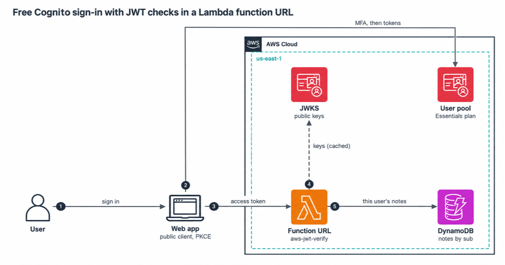

# cognito-free-auth

Sign-in for up to 10,000 monthly active users at $0, with Amazon Cognito on the Essentials plan, and a small notes API on an AWS Lambda function URL that checks every Cognito token itself.

This is the code for the InfraTales article "Sign-in for 10,000 users at $0 with Amazon Cognito" on AWS Builder Center.

## Architecture



## What you get

| Piece | What it does |
|---|---|
| Cognito user pool, Essentials plan | Email sign-up, managed login, passkeys, TOTP MFA required, no SMS anywhere |
| App client | Public client with no secret. Code grant with PKCE for managed login, `USER_AUTH` and SRP for SDK sign-in |
| Tokens | 15-minute access and ID tokens, 30-day refresh tokens with rotation, revocation on |
| Lambda function URL | Node.js 24 on arm64, capped at 2 parallel copies. Verifies access tokens with `aws-jwt-verify`, caches the signing keys, returns only the caller's notes |
| DynamoDB table | Notes keyed by the token's `sub`. Provisioned at 5 read and 5 write units, inside the always-free 25 and 25 |

## Try it without an AWS account

You need Node.js 24 and npm. Docker is only for the DynamoDB Local tests.

```bash
npm ci
npm run check
```

`npm run check` type-checks, lints, bundles the function, runs the unit and CDK template tests, and synthesizes the stack with cdk-nag. The token tests sign JWTs with keys made during the test and serve the public keys from a local HTTPS server, so they run the real `aws-jwt-verify` code with no Cognito involved.

To run the handler against a real DynamoDB engine:

```bash
docker run -d --rm -p 8014:8000 amazon/dynamodb-local:3.3.2
AWS_ENDPOINT_URL_DYNAMODB=http://localhost:8014 npm run test:int
```

## Deploy

You need a CDK-bootstrapped account. Pick a domain prefix that no other account in the Region uses, and list your app's URLs:

```bash
npm run bundle
npx cdk deploy -c domainPrefix=my-notes-4821 -c appUrls=https://app.example.com/,http://localhost:5173/
npm run smoke
```

The smoke test creates a throwaway user, sets up TOTP MFA for it, calls the API with its access token, checks that the API refuses its ID token, and deletes the user. That user counts as one monthly active user.

## Clean up

The user pool and the table have deletion protection, so `npm run destroy` leaves them in place on purpose. [docs/runbook.md](docs/runbook.md) has the steps to remove them.

## More

- [docs/security.md](docs/security.md): what each setting protects against, and what it doesn't
- [docs/cost.md](docs/cost.md): what stays free, and the settings that start a bill
- [docs/runbook.md](docs/runbook.md): deploy, rotate, debug and remove

Licensed MIT-0. Created by Rahul Ladumor / InfraTales, with no affiliation to AWS.
